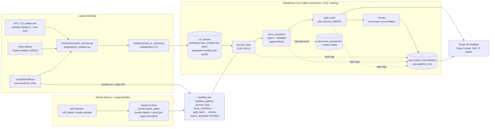
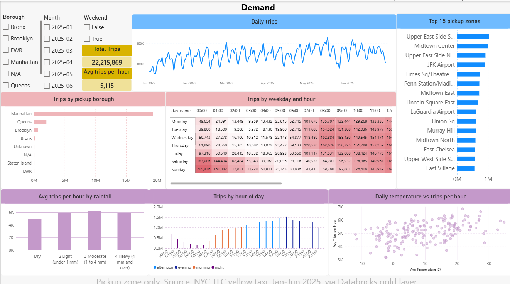
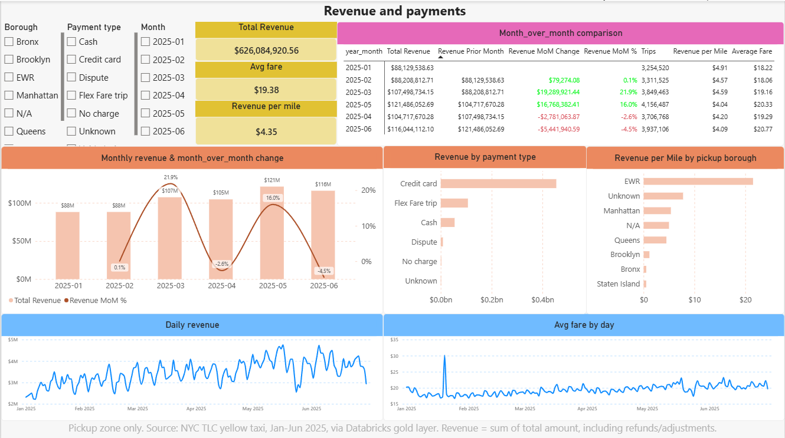
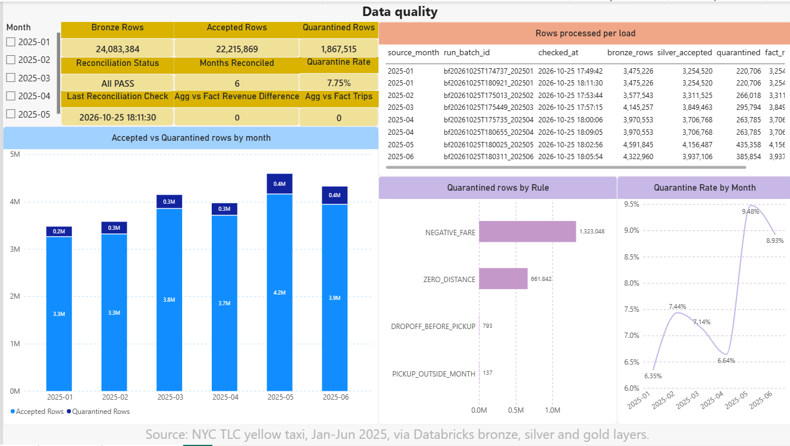

# TaxiLake

A medallion lakehouse on **Databricks Free Edition** that turns NYC TLC yellow-taxi trips and hourly Open-Meteo weather into a reconciled star schema for Power BI. Monthly files are landed from a laptop, loaded into bronze, silver and gold Delta tables with PySpark, orchestrated by a Lakeflow job, and deployed with Databricks Asset Bundles and GitHub Actions. Everything runs on free tiers.

The data covers **January to June 2025** (six months, chosen to stay inside the Free Edition daily quota). Rows that fail a quality rule are never dropped silently: they go to a quarantine table with a stable reason code, and every layer is reconciled against the one before it.

The results below are based on recorded Databricks runs and subsequent read-only validation. Detailed execution records are in [`docs/RUNLOG.md`](docs/RUNLOG.md).

## Architecture



Schema names in the diagram are the production names. The `dev` target uses the same names with a `dev_` prefix (`workspace.dev_bronze`, `workspace.dev_landing.raw` and so on). `scripts/backfill.py` is hard-wired to the dev namespace, and `scripts/upload_to_volume.py` defaults to the dev volume (it writes to the production volume only if `--env prod` is passed explicitly). The Power BI model has an `Environment` parameter (`prod` by default, or `dev`) that selects which set of schemas its queries read.

| Component | Tool | Role |
|---|---|---|
| Landing | Python scripts on the laptop, Databricks CLI | Download the month's files, upload them to a Unity Catalog volume (skipped when an identical file is already there) |
| Storage and compute | Databricks Free Edition: serverless, Unity Catalog, Delta Lake | Bronze, silver, gold and ops tables in catalog `workspace` |
| Transformations | PySpark, Spark SQL (`src/taxilake/`, `notebooks/`) | `COPY INTO`, typed and validated silver, star-schema gold with `MERGE` |
| Orchestration | Lakeflow Jobs | `taxilake_pipeline`: four dependent tasks, 2 retries each, monthly schedule defined but **PAUSED** |
| Deployment | Databricks Asset Bundles (`databricks.yml`) | `dev` target (laptop) and `prod` target (CI only, service principal, one job) |
| CI/CD | GitHub Actions | Lint, tests, bundle validation on pull requests; guarded deployment after merge |
| Reporting | Power BI Desktop | Import model over the gold layer plus data-quality tables, DAX measures, three pages |
| Tests | pytest, local PySpark | Transformation logic, failure cases, bundle and workflow guard tests |

## Results (January to June 2025)

| Month | Bronze rows | Silver accepted | Quarantined | Quarantine rate | Duplicates removed | Whole-job runtime |
|---|---:|---:|---:|---:|---:|---:|
| 2025-01 | 3,475,226 | 3,254,520 | 220,706 | 6.35% | 0 | 127.1 s (smoke run on the already-loaded month) |
| 2025-02 | 3,577,543 | 3,311,525 | 266,018 | 7.44% | 0 | 201.8 s (includes a deliberate failure and retry, below) |
| 2025-03 | 4,145,257 | 3,849,463 | 295,794 | 7.14% | 0 | 135.4 s |
| 2025-04 | 3,970,553 | 3,706,768 | 263,785 | 6.64% | 0 | 144.1 s |
| 2025-05 | 4,591,845 | 4,156,487 | 435,358 | 9.48% | 0 | 141.5 s |
| 2025-06 | 4,322,960 | 3,937,106 | 385,854 | 8.93% | 0 | 151.9 s |
| **Total** | **24,083,384** | **22,215,869** | **1,867,515** | **7.75%** | **0** | 774.7 s for the five runs 2025-02 to 2025-06 |

- `22,215,869 + 1,867,515 + 0 = 24,083,384`: every bronze row is accounted for. Each month's bronze row count equals the row count in its source Parquet footer. `gold.fact_trips` has 22,215,869 rows with 22,215,869 distinct keys, 0 orphan dimension keys, and `dim_date` covers 181 days. The Delta size of `fact_trips` was 1,443,995,102 bytes.
- Quarantine rows by rule (a row can break several rules, so the counts overlap): `NEGATIVE_FARE` 1,323,048; `ZERO_DISTANCE` 661,842; `DROPOFF_BEFORE_PICKUP` 793; `PICKUP_OUTSIDE_MONTH` 137.
- **Retry test:** for 2025-02 a controlled failure was injected into `silver_transform`; attempt 0 failed, attempt 1 succeeded, the job succeeded and reconciliation passed.
- **Idempotency test:** re-running 2025-04 and 2025-01 left silver, quarantine and gold fingerprints unchanged; the gold `MERGE` reported 0 inserted / 0 updated / 0 deleted and `COPY INTO` added nothing.
- Runtimes are whole-job durations from the Databricks run records on serverless compute. They include queueing and are not performance benchmarks.

## Design

**Incremental loading.** The pipeline processes one month per run (parameters `catalog`, `environment`, `month`, `batch_id`, `inject_failure`). `scripts/backfill.py` lands, uploads and runs the months in order, stops at the first failed month, and `--resume` skips months already reconciled as `PASS`.

**Idempotency, layer by layer.**
- *Bronze:* `COPY INTO` remembers which files it already loaded into each table, so a re-run inserts zero rows. Each row carries `_source_file`, `_ingested_at` and `_batch_id`.
- *Silver:* the month's slice of `silver.trips` and `silver.trips_quarantine` is replaced with Delta `replaceWhere`, so a re-run rewrites the same slice instead of appending.
- *Gold:* `MERGE` on `trip_key`. A matched row is updated only when its `row_hash` (a hash of its content) changed, and rows the month no longer has are deleted, so an unchanged re-run writes nothing. Aggregates are rebuilt per month with `replaceWhere`.

**Data quality and quarantine.** Silver applies explicit rules (negative fare, zero distance, dropoff before pickup, pickup outside the file's month, and others). A rejected row keeps its data plus an array of reason codes. Exact duplicates are counted, not hidden: `bronze = accepted + quarantined + duplicates removed` is asserted by the silver task.

**Reconciliation.** The `checks` task recomputes counts from the tables across all layers (de-duplication, silver and quarantine totals, fact rows, amount sums, orphan keys, aggregate trips) and appends one row to `ops.month_reconciliation` with a content fingerprint of the gold slice. It fails the task if anything differs. The fingerprint is how re-runs were proved unchanged. The key and row hashes include the source file path, so identical data loaded through the dev and production volumes has different fingerprints.

**Retries.** Each task retries twice with a 30 s interval. All tasks are idempotent, so a retry can safely repeat work; the controlled failure test above shows a retry succeeding.

**Observability.** Every task appends one row per attempt to `ops.pipeline_runs`: month, batch, task, attempt, job and task run ids, start and end time, duration, status, `rows_read`, `rows_written`, `rows_quarantined`, task-specific details and an error message. The success row is written only after all data work and assertions finish, and if that write fails the task fails, so a successful transformation is never reported without evidence (the retry is safe because the data work is idempotent). A failed task logs a `FAILED` row on a best-effort basis; if that write also fails, the original error still surfaces. Counts that do not apply hold `NULL`, never zero.

**Pipeline freshness (not source age).** For each month, freshness is the time since the last *complete successful run*: all four tasks succeeded in the same batch and `ops.month_reconciliation` holds a `PASS` for that batch. States: `FRESH` (within the threshold, default 35 days), `STALE`, `FAILED_LAST_RUN`, `INCOMPLETE_LAST_RUN`, `NEVER_RUN`. The input is a fixed historical range, so the newest month loaded is reported separately as *coverage*, never as freshness. Because the schedule is paused, the state correctly turns `STALE` as time passes, and months loaded before `ops.pipeline_runs` existed report `NEVER_RUN`; neither is a failed check. Logic: [`src/taxilake/freshness.py`](src/taxilake/freshness.py); report: [`notebooks/freshness_check.py`](notebooks/freshness_check.py).

## CI/CD

- **Pull request into `main`:** `ruff`, formatting check, `actionlint`, `pytest` with local Spark (Java 17 in CI), and `bundle validate -t prod`. Never deploys, never starts a job.
- **Push to `main`:** the same checks again on the pushed commit, a gate that the commit belongs to a merged pull request, a `DEPLOY_ENABLED` kill-switch variable, a protected `production` environment, then `bundle deploy -t prod` and a safety check that production holds only `taxilake_pipeline`, with its schedule `PAUSED` and its `environment` parameter set to `prod`. Credentials are an OAuth machine-to-machine service principal stored as GitHub secrets; nothing secret is in the repository.
- **The production schedule stays `PAUSED`**, and no workflow starts a job, runs SQL, uploads data or backfills. Landing runs on the laptop, so a scheduled cloud run would find no files for the month. Enabling the schedule is a deliberate manual step for after landing is automated.
- `databricks.yml` excludes `powerbi/*.pbix` and `docs/img/**` from bundle uploads.

Setup steps: [`docs/CICD.md`](docs/CICD.md).

### Production deployment status

**Reported by the repository owner (GitHub):**
- The required pull-request checks passed, and the `deploy` workflow deployed the production bundle through GitHub Actions on 30 October 2026 from `main` commit `83cbb43`.
- The later documentation-only merge (`678f4ac`) did not trigger another production deployment. `DEPLOY_ENABLED=false` is the intended resting state.

**Observed directly (Databricks, read-only, after the `83cbb43` deployment):**
- The existing production job was updated in place (same job id), not duplicated; the workspace has exactly one production `taxilake_pipeline`.
- Its definition contains `environment=prod` and the per-task run-ID parameters.
- The schedule is `PAUSED` and the job has zero runs. Its creator and run-as identity are the same service principal.
- Production table counts, Delta versions, reconciliation records and pipeline-run records are unchanged from the pre-deployment baseline.

The production pipeline has deliberately never been executed, so a production run is untested. Records: [`docs/RUNLOG.md`](docs/RUNLOG.md).

## Reproduce it

This is the **development workflow**. It reads and writes the `dev_`-prefixed schemas (`workspace.dev_bronze` and so on) and the volume `workspace.dev_landing.raw`; nothing in these steps loads the production-named tables. The commands use PowerShell and Windows paths (the Python scripts are cross-platform but have only been run on Windows).

**Prerequisites**
- A Databricks Free Edition workspace (serverless compute only). Use the built-in Serverless Starter Warehouse for SQL.
- Python 3.12 (tested with 3.12.10) and the [Databricks CLI](https://docs.databricks.com/aws/en/dev-tools/cli/install) (tested with v1.22.1).
- **Java 21** for the local PySpark tests (tested with OpenJDK 21.0.12). PySpark 4 needs Java 17 or newer, and CI uses Java 17.
- Power BI Desktop (Windows), only for the report.
- About 70 MB of free disk per month of data (the April 2025 file is 67,352,824 bytes) under `data/`, which is git-ignored.
- Never put tokens or workspace URLs into files; the CLI profile and GitHub secrets hold them.

### 1. Local environment

```powershell
python -m venv .venv
.\.venv\Scripts\python.exe -m pip install -r requirements-dev.txt
.\.venv\Scripts\python.exe -m pytest -q
```

All 273 tests pass (about 2.5 minutes).

### 2. Authenticate

```powershell
databricks auth login --host <your-workspace-url> --profile taxilake-dev
$env:DATABRICKS_CONFIG_PROFILE = "taxilake-dev"
databricks current-user me
```

The last command prints your account if the profile works. The scripts read the profile from `DATABRICKS_CONFIG_PROFILE` or `--profile`.

### 3. Create the development schemas, volume and tables

The files in `sql/` are the production DDL. `scripts/render_sql.py` rewrites every `workspace.<layer>` name to `workspace.dev_<layer>` and prints the result; it never connects to Databricks. It prints the six files in the order they must run: `00_setup_catalog.sql` (schemas and volume), `10_bronze_tables.sql`, `20_silver_tables.sql`, `30_gold_tables.sql`, `40_ops_tables.sql`, `41_ops_pipeline_runs.sql`. (`31_migrate_fact_row_hash.sql` only upgrades an old production table and is intentionally not rendered.)

1. Copy the rendered DDL to the clipboard and read it before running it:
   ```powershell
   .\.venv\Scripts\python.exe scripts\render_sql.py --env dev | Set-Clipboard
   ```
2. In the Databricks workspace open **SQL Editor**, paste, select all (Ctrl+A) and **Run**, so that every statement runs and not only the one under the cursor. Every statement is `CREATE ... IF NOT EXISTS`, so re-running is safe.
3. Check: `SHOW SCHEMAS IN workspace` lists `dev_landing`, `dev_bronze`, `dev_silver`, `dev_gold` and `dev_ops`; `SHOW TABLES IN workspace.dev_ops` lists `month_reconciliation`, `failure_injection` and `pipeline_runs`; `SHOW VOLUMES IN workspace.dev_landing` lists `raw`.

The catalog is the built-in `workspace` catalog, because Free Edition has no separate catalog to create.

### 4. Deploy the development bundle

```powershell
databricks bundle validate -t dev -p taxilake-dev
databricks bundle deploy -t dev -p taxilake-dev
```

This deploys the job `taxilake_pipeline` (development mode, so Databricks prefixes its name) and syncs `notebooks/` and `src/` to your workspace folder `.bundle/taxilake/dev/files`. On a fresh clone `bundle validate` prints one warning because the sync exclude pattern `powerbi/*.pbix` matches no file (the report is intentionally not in Git); this is expected. Never deploy `prod` from a laptop: that target belongs to CI.

### 5. Check the range before using compute

```powershell
.\.venv\Scripts\python.exe scripts\backfill.py --start 2025-01 --end 2025-06 --dry-run
```

This downloads the upstream files into `data/landing/`, compares each Parquet schema with the bronze DDL and prints the source row count per month (they equal the bronze row counts in the results table). It uploads nothing and starts no cloud run.

### 6. Land and load one month: the April 2025 run

```powershell
.\.venv\Scripts\python.exe scripts\backfill.py --only 2025-04
```

For the month this downloads the TLC file and the zone CSV, fetches the Open-Meteo weather, uploads all three to `workspace.dev_landing.raw` (a file already there with the same size is skipped), runs the job with `environment=dev`, and checks the reconciliation row. To do only the upload, run `scripts\download_sources.py --month 2025-04`, `scripts\fetch_weather.py --month 2025-04` and `scripts\upload_to_volume.py --month 2025-04`.

Expected result: bronze 3,970,553 rows, silver accepted 3,706,768, quarantined 263,785, duplicates removed 0, reconciliation `PASS`, and the command ends with `all requested months reconciled`. The first load into empty dev tables took 173,990 ms (`job_ms`). Running the same command again changes nothing: `COPY INTO` and the gold `MERGE` write 0 rows.

For all six months run `scripts\backfill.py --start 2025-01 --end 2025-06 --resume`. It stops at the first failed month, and `--resume` skips months already reconciled as `PASS`. A six-month backfill into the dev namespace has not been run; only 2025-04 has been loaded there.

### 7. Check the results

In the SQL editor:

```sql
SELECT source_month, bronze_rows, silver_accepted, quarantined, duplicates_removed, status
FROM workspace.dev_ops.month_reconciliation ORDER BY source_month, checked_at;

SELECT source_month, task_key, attempt, status, rows_read, rows_written, rows_quarantined
FROM workspace.dev_ops.pipeline_runs ORDER BY finished_at;
```

Expect `status = PASS` and the counts above. After the first April run `pipeline_runs` holds four `SUCCESS` rows (`bronze_load`, `silver_transform`, `gold_build`, `checks`), with `bronze_load` writing 3,970,553 rows. Each further run of the same month adds four more rows, and `bronze_load` and `gold_build` then show `rows_written = 0`.

### 8. Run the freshness check

`notebooks/freshness_check.py` is read-only and is not part of the job. Open it in the workspace under **Workspace > Users > (you) > .bundle > taxilake > dev > files > notebooks**, attach **Serverless** compute, leave the widget `environment` at `dev`, and choose **Run all**. It prints one line per expected month and a coverage line:

| State | Meaning |
|---|---|
| `FRESH` | the last complete successful run (all four tasks succeeded in one batch and the reconciliation for it is `PASS`) is not older than `max_age_hours` (default 840 h, 35 days) |
| `STALE` | there is such a run, but it is older than the threshold; expected over time because the schedule is paused |
| `FAILED_LAST_RUN` / `INCOMPLETE_LAST_RUN` | the newest batch has a failed task, or a task or the `PASS` reconciliation is missing |
| `NEVER_RUN` | no run of that month is recorded in `pipeline_runs` |

The overall state is the worst month. With only 2025-04 loaded in dev, the report shows 2025-04 `FRESH` and the other five months `NEVER_RUN`, so the overall state is `NEVER_RUN`: that is the expected result for one loaded month, not a failure. To judge only the month you loaded, set the widgets `start_month` and `end_month` to `2025-04`; the overall state should then be `FRESH` (derived from the logic and its unit tests, not run). Set `fail_if_not_fresh` to `true` to make the notebook fail instead of only printing. "Fresh" means the pipeline ran recently, not that the data is recent.

### 9. Open the Power BI report

See [Power BI report](#power-bi-report) below. The report file itself is not published.

### Validation summary

- **Automated checks:** 273 tests pass and `ruff` is clean, locally and in a clean checkout. The GitHub pull-request CI checks passed (reported by the repository owner).
- **Clean-checkout reproduction:** an independent newcomer followed this workflow from a clean Git checkout: environment setup, 273 passing tests, authentication, the six-month dry run, development bundle deployment, the April 2025 development backfill, the reconciliation and run-log queries, and the freshness notebook all succeeded. It reused the existing Databricks workspace, development schemas, volume and tables (so step 3 was not exercised and the April run was a repeat on loaded data); it was **not** a newly provisioned workspace. The README has been edited since that test.
- **Production:** bundle deployment through GitHub Actions and read-only verification of the result succeeded (see CI/CD above).
- **Not tested:** a six-month development backfill; a complete Power BI report rebuild from a blank report; a new Databricks workspace set up from scratch; execution of the production job.

## Power BI report

Import-mode star schema over the gold layer (`dim_date`, `dim_time_of_day`, `dim_zone`, `dim_payment_type`, an hourly-grain `fact_trips_hourly`, the gold aggregates and the data-quality tables): 11 tables and 10 many-to-one, single-direction relationships. Measures: Total Revenue, Trips, Average Fare, Revenue per Mile, Revenue MoM %, and data-quality measures. All 15 DAX validation queries matched the values computed with SQL, and all 11 model tables loaded in under 30 seconds (reported by the author, on the production-named tables). The report uses an hourly-grain fact rather than the 22,215,869-row trip-level fact, so it has no dropoff zone or per-trip view.

| Demand | Revenue and payments | Data quality |
|---|---|---|
|  |  |  |

The screenshots come from the author's own report, which reads the production-named tables.

**Set up the model.** The `.pbix` is not published, so the model is provided as a TMDL script (`createOrReplace`) that you apply to a Power BI Desktop model. It cannot be opened as a file.

1. In Power BI Desktop open a **blank report** (or, to protect an existing report, a **copy** of its `.pbix` kept outside the repository). If **TMDL view** is missing from the left strip, enable it under File > Options and settings > Options > Preview features and restart.
2. In TMDL view open a new tab, paste the whole content of `powerbi/model/taxilake_model.tmdl` and click **Apply**.
3. Home > **Transform data** > **Edit parameters**: set `ServerHostname` and `HttpPath` (Databricks > SQL Warehouses > Serverless Starter Warehouse > Connection details). Applying the script resets both to placeholders, so set them before refreshing. Leave `Catalog` = `workspace`. Set **`Environment` to `dev`** to read the development schemas (`workspace.dev_gold`, `workspace.dev_ops`, `workspace.dev_silver`, which is where the steps above write); `prod`, the default, reads the production-named `workspace.gold`, `workspace.ops` and `workspace.silver`.
4. Refresh, sign in with the Databricks connector (browser OAuth), and approve the two native-query prompts (`fact_trips_hourly` and `dq_quarantine_by_rule`). The prompts show the SQL, which should name `workspace.dev_gold` and `workspace.dev_silver` when `Environment` is `dev`.
5. In DAX query view run `powerbi/validation/validate_measures.dax` and compare with `powerbi/validation/expected_values.md`. Those expected values were measured on the six-month production-named data; with only April loaded in dev, compare just the April rows.
6. Build the three pages from `powerbi/REPORT_SPEC.md`.

**Validation status.** The model script was applied to a copy of an existing `.pbix` with `Environment = dev` and refreshed against the April 2025 development data (reported by the author). A complete rebuild from a blank report has not been tested.

The `.pbix` is intentionally excluded from Git because the saved model may contain the real Databricks hostname and HTTP path; `scripts/check_pbix.py` inspects a local file for such values but cannot read the compressed model.

## Limitations

1. **Data coverage:** January to June 2025 only, not a continuous feed. Nothing here measures how the pipeline behaves on a month that was not tested.
2. **Laptop-based landing:** download and upload run on the author's machine, so continuous automated ingestion is not implemented and the production schedule stays `PAUSED` (a scheduled cloud run would find no new files). The pipeline job itself runs in Databricks.
3. **Free Edition constraints:** serverless compute only, a daily compute quota, no account console (so no OIDC federation for CI; a service-principal secret is used), and the built-in `workspace` catalog instead of a dedicated one. Months run one at a time.
4. **Namespace-based separation, not access control:** development and production share one catalog and are separated by schema naming (`dev_` prefix). One user owns both namespaces. Two development runs of 2025-04 wrote only to the `dev_` schemas and left the production-named tables unchanged.
5. **Production run and permissions untested:** The production service principal's Unity Catalog grants have not been verified. Production execution may fail if the required permissions are missing; no production job has been executed.
6. **Deployment approval is not separation of duties:** the same repository owner merges the pull request and approves the `production` deployment.
7. **The Power BI `.pbix` is not published** (see above); the repository provides the TMDL model, DAX validation queries, expected values, report specification and screenshots instead.
8. **Revenue and weather:** revenue is the sum of `total_amount` and includes 1,592 trips with a negative total. Weather charts show associations, not causes.
9. **Observability scope:** run logging and freshness were verified in development for February and April only. Those two test runs wrote to the production-named tables, which therefore hold 9 `ops.pipeline_runs` rows from them; the other four months have no `pipeline_runs` rows. Per-task metrics for both months are in [`docs/RUNLOG.md`](docs/RUNLOG.md).
10. **Performance:** silver rewrites each month's partition on every run, and the gold `MERGE` and the reconciliation still scan the month (the `MERGE` to compare hashes, `checks` to recompute de-duplication).

## Repository map

| Path | Content |
|---|---|
| `src/taxilake/` | Pure, tested logic: silver rules, gold builders, reconciliation, run logging, freshness, backfill helpers |
| `notebooks/` | Databricks notebooks: `bronze_load`, `silver_transform`, `gold_build`, `checks`, `freshness_check` |
| `sql/` | Table DDL, in numeric order |
| `scripts/` | Laptop landing, upload, backfill driver, DDL rendering, deployment and report-file checks |
| `databricks.yml`, `.github/workflows/` | Asset Bundle (dev and prod) and CI/CD |
| `powerbi/` | Power BI model script, validation queries, expected values, report specification (the `.pbix` stays local) |
| `docs/` | CI/CD setup (`CICD.md`), execution run log (`RUNLOG.md`), Power BI screenshots (`img/`) |
| `tests/` | Unit and guard tests (`pytest`) |

## License

TaxiLake's original project source code is released under the [MIT License](LICENSE), Copyright (c) 2026 Shubham Vijay Kawde.

The MIT License applies only to the original project code. Third-party datasets, services, dependencies, trademarks and other externally provided materials remain subject to their respective licenses and terms:

- **NYC TLC trip records.** The yellow-taxi trip data is obtained from the [NYC Taxi and Limousine Commission](https://www.nyc.gov/site/tlc/about/tlc-trip-record-data.page). Its use remains subject to the applicable NYC/TLC terms. These records are collected and provided to TLC by technology providers; they are not original data created by this project or relicensed under MIT.

- **Open-Meteo weather data.** API data is licensed under [Creative Commons Attribution 4.0 International (CC BY 4.0)](https://creativecommons.org/licenses/by/4.0/). Attribution is required, and modifications must be indicated. Attribution: [Weather data by Open-Meteo.com](https://open-meteo.com/). The free API is subject to Open-Meteo's non-commercial usage terms.

- **Dependencies.** Python packages, Databricks components and other third-party software remain subject to their respective licenses.

- **Platforms and services.** Databricks Free Edition, Power BI and other external services are governed by their providers' terms. The MIT License does not grant rights to use those services or their associated assets.

The MIT License does not override or replace any third-party license or service terms.