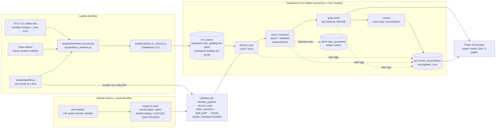

# TaxiLake

A medallion lakehouse on **Databricks Free Edition**: NYC TLC yellow-taxi trips and hourly Open-Meteo weather are landed from a laptop, loaded into bronze, silver and gold Delta tables with PySpark, orchestrated by a Lakeflow job, deployed with Databricks Asset Bundles and GitHub Actions, and reported on in Power BI. Everything uses free tiers.

Scope of the data: **January to June 2025** (6 months, chosen to stay inside the Free Edition daily quota). Rows that fail a quality rule are never dropped silently: they go to a quarantine table with a stable reason code, and every layer is reconciled against the one before it.

**How to read the numbers in this README.** Each figure comes from [`docs/RUNLOG.md`](docs/RUNLOG.md) and is labelled: *historical run* (a recorded Databricks run on 2026-10-25), *re-verified* (queried again later, see the phase checklists), or *author-reported* (stated by the author, not independently measured). Nothing is estimated.

## Architecture



Schema names in the diagram are the production names. The `dev` target uses the same names with a `dev_` prefix (`workspace.dev_bronze` and so on), and `scripts/backfill.py` and `scripts/upload_to_volume.py` work on the dev copy only. The Power BI model script has an `Environment` parameter (`prod` by default, or `dev`) that selects which set of schemas its queries read; the author's report reads the production-named tables, and the reproduction steps below use `dev`.

| Component | Tool | Role |
|---|---|---|
| Landing | Python scripts on the laptop, Databricks CLI | Download the month's files, upload them to a Unity Catalog volume (skipped when an identical file is already there) |
| Storage and compute | Databricks Free Edition: serverless, Unity Catalog, Delta Lake | Bronze, silver, gold and ops tables in catalog `workspace` |
| Transformations | PySpark, Spark SQL (`src/taxilake/`, `notebooks/`) | `COPY INTO`, typed and validated silver, star-schema gold with `MERGE` |
| Orchestration | Lakeflow Jobs | `taxilake_pipeline`: four dependent tasks, 2 retries each, monthly schedule defined but **PAUSED** |
| Deployment | Databricks Asset Bundles (`databricks.yml`) | `dev` target (laptop) and `prod` target (CI only, service principal, one job) |
| CI/CD | GitHub Actions | Lint, tests, bundle validation on pull requests; guarded deployment after merge |
| Reporting | Power BI Desktop | Import model over the gold layer plus data-quality tables, DAX measures, three pages |
| Tests | pytest, local PySpark | Transformation logic, failure cases, bundle and workflow guard tests |

## Results (January to June 2025)

All values below are from **historical runs** on 2026-10-25 recorded in [`docs/RUNLOG.md`](docs/RUNLOG.md) (Phase 4 rows), and were **re-verified** by read-only queries in the Phase 4 verification.

| Month | Bronze rows | Silver accepted | Quarantined | Quarantine rate | Duplicates removed | Whole-job runtime |
|---|---:|---:|---:|---:|---:|---:|
| 2025-01 | 3,475,226 | 3,254,520 | 220,706 | 6.35% | 0 | 127.1 s (smoke run on the already-loaded month) |
| 2025-02 | 3,577,543 | 3,311,525 | 266,018 | 7.44% | 0 | 201.8 s (includes a deliberate failure and retry, below) |
| 2025-03 | 4,145,257 | 3,849,463 | 295,794 | 7.14% | 0 | 135.4 s |
| 2025-04 | 3,970,553 | 3,706,768 | 263,785 | 6.64% | 0 | 144.1 s |
| 2025-05 | 4,591,845 | 4,156,487 | 435,358 | 9.48% | 0 | 141.5 s |
| 2025-06 | 4,322,960 | 3,937,106 | 385,854 | 8.93% | 0 | 151.9 s |
| **Total** | **24,083,384** | **22,215,869** | **1,867,515** | **7.75%** | **0** | 774.7 s for the five runs 2025-02 to 2025-06 |

- `22,215,869 + 1,867,515 + 0 = 24,083,384`: every bronze row is accounted for. Each month's bronze row count equals the row count in its source Parquet footer. `gold.fact_trips` has 22,215,869 rows with 22,215,869 distinct keys, 0 orphan dimension keys, and `dim_date` covers 181 days. The Delta size of `fact_trips` was 1,443,995,102 bytes.
- Quarantine rows by rule (a row can break several rules, so the counts overlap): `NEGATIVE_FARE` 1,323,048; `ZERO_DISTANCE` 661,842; `DROPOFF_BEFORE_PICKUP` 793; `PICKUP_OUTSIDE_MONTH` 137.
- **Retry test (historical run):** for 2025-02 a controlled failure was injected into `silver_transform`; attempt 0 failed, attempt 1 succeeded, the job succeeded and reconciliation passed.
- **Idempotency test (historical run):** re-running 2025-04 and 2025-01 left silver, quarantine and gold fingerprints unchanged; the gold `MERGE` reported 0 inserted / 0 updated / 0 deleted and `COPY INTO` added nothing.
- Runtimes are whole-job durations from the Databricks run records on serverless compute; they include queueing and are not benchmarks.
- Local tests (checked 2026-10-29): 273 passed (`pytest`), `ruff` clean.

## Design

**Incremental loading.** The pipeline processes one month per run (parameters `catalog`, `environment`, `month`, `batch_id`, `inject_failure`). `scripts/backfill.py` lands, uploads and runs the months in order, stops at the first failed month, and `--resume` skips months already reconciled as PASS.

**Idempotency, layer by layer.**
- *Bronze:* `COPY INTO` remembers which files it already loaded into each table, so a re-run inserts zero rows. Each row carries `_source_file`, `_ingested_at` and `_batch_id`.
- *Silver:* the month's slice of `silver.trips` and `silver.trips_quarantine` is replaced with Delta `replaceWhere`, so a re-run rewrites the same slice instead of appending.
- *Gold:* `MERGE` on `trip_key`. A matched row is updated only when its `row_hash` (a hash of its content) changed, rows the month no longer has are deleted, so an unchanged re-run writes nothing. Aggregates are rebuilt per month with `replaceWhere`.

**Data quality and quarantine.** Silver applies explicit rules (negative fare, zero distance, dropoff before pickup, pickup outside the file's month, and others). A rejected row keeps its data plus an array of reason codes. Exact duplicates are counted, not hidden: `bronze = accepted + quarantined + duplicates removed` is asserted by the silver task.

**Reconciliation.** The `checks` task recomputes counts from the tables across all layers (de-duplication, silver and quarantine totals, fact rows, amount sums, orphan keys, aggregate trips) and appends one row to `ops.month_reconciliation` with a content fingerprint of the gold slice; it fails the task if anything differs. The fingerprint is how re-runs were proved unchanged.

**Retries.** Each task retries twice with a 30 s interval. All tasks are idempotent, so a retry can safely repeat work. The controlled failure test above shows a retry succeeding.

**Observability (Phase 7; verified in the development workspace for 2025-02 and 2025-04, user-reported).** Every task appends one row per attempt to `ops.pipeline_runs`: month, batch, task, attempt, job and task run ids, start and end time, duration, status, `rows_read`, `rows_written`, `rows_quarantined`, task-specific details and an error message. The success row is written only after all data work and assertions finish, and if that write fails the task fails, so a successful transformation is never reported without evidence (the retry is safe because the data work is idempotent). A failed task logs a FAILED row on a best-effort basis; if that write also fails, the original error still surfaces. Rows with *not applicable* counts hold NULL, never zero.

**Freshness (pipeline freshness, not source age).** For each month, freshness is the time since the last *complete successful run*: all four tasks succeeded in the same batch and `ops.month_reconciliation` holds a PASS for that batch. States: `FRESH` (within the threshold, default 35 days), `STALE`, `FAILED_LAST_RUN`, `INCOMPLETE_LAST_RUN`, `NEVER_RUN`. The input is a fixed historical range, so the newest month loaded is reported separately as *coverage*, never as freshness. Because the schedule is paused, the state will correctly turn `STALE` as time passes. Observed in dev (user-reported, 2026-10-28): 2025-02 and 2025-04 `FRESH`; 2025-01, 03, 05 and 06 `NEVER_RUN` because they were loaded in Phase 4, before `ops.pipeline_runs` existed; overall `NEVER_RUN`, which is expected for the current state and is not a failed check. Logic: [`src/taxilake/freshness.py`](src/taxilake/freshness.py); report: [`notebooks/freshness_check.py`](notebooks/freshness_check.py).

## CI/CD

- **Pull request into `main`:** `ruff`, formatting check, `actionlint`, `pytest` with local Spark, and `bundle validate -t prod`. Never deploys, never starts a job.
- **Push to `main`:** the same checks again on the pushed commit, a gate that the commit belongs to a merged pull request, a `DEPLOY_ENABLED` kill-switch variable, a protected `production` environment, then `bundle deploy -t prod` and a safety check that production holds only `taxilake_pipeline` with its schedule PAUSED. Credentials are an OAuth machine-to-machine service principal stored as GitHub secrets; nothing secret is in the repository.
- **The production schedule stays PAUSED**, and no workflow starts a job, runs SQL, uploads data or backfills. Landing runs on the laptop, so a scheduled cloud run would find no files for the month. Enabling the schedule is a deliberate manual step for after landing is automated.
- Setup steps: [`docs/CICD.md`](docs/CICD.md). Status: the author confirmed the Phase 5 done-check; the GitHub workflow results are not recorded in the run log.
- `databricks.yml` excludes `powerbi/*.pbix` and `docs/img/**` from bundle uploads.

## Reproduce it

This is the **development flow**: everything below reads and writes the `dev_`-prefixed schemas (`workspace.dev_bronze` and so on) and the volume `workspace.dev_landing.raw`. The scripts cannot write to the production-named tables, and nothing in this README loads them.

**Status of these steps.** *(author-run)* = the author executed the step in this project. *(observed 2026-10-28)* = executed and checked by the assistant through the CLI, with the results in [`docs/RUNLOG.md`](docs/RUNLOG.md). *(manual check)* = described from the code, not yet run by anyone from this text; do it and compare with the expected result. **Independent newcomer test: PASSED (reported by the author, 2026-10-30).** A friend of the author who was new to the project cloned branch `readme-clean-test` (commit `79bf377`) into a separate folder and followed the development steps 1, 2, 4, 5 and 6, then checked the results as in steps 7 and 8. **The tester reused the existing Databricks Free Edition workspace, dev schemas, volume and tables**; **provisioning a brand-new workspace from scratch has not been tested.** The April run was a repeat on already-loaded dev data, not a first load into empty tables. **The workflow was tested at commit `79bf377`; README and documentation edits made after that commit were not independently tested.** Not tested: the six-month dev backfill and a Power BI rebuild from a blank report using the model script (applying the script to a copy of an existing report with `Environment = dev` was validated by the author, user-reported, 2026-10-30).

**Prerequisites**
- A Databricks Free Edition workspace (serverless compute only; use the built-in Serverless Starter Warehouse for SQL).
- Python 3.12 (author: 3.12.10) and the [Databricks CLI](https://docs.databricks.com/aws/en/dev-tools/cli/install) (author: v1.22.1).
- **Java 21** for the local PySpark tests (author: OpenJDK 21.0.12). PySpark 4 needs Java 17 or newer; the GitHub workflow pins Java 17, and no recorded run shows that CI result.
- PowerShell (the commands below use Windows paths; the Python scripts themselves are cross-platform but were only run on Windows).
- Power BI Desktop (Windows) for the report, optional.
- About 70 MB of free disk per month of data (the April 2025 file is 67,352,824 bytes) under `data/`, which is git-ignored.
- Never put tokens or workspace URLs into files: the CLI profile and GitHub secrets hold them.

### 1. Local environment *(author-run)*

```powershell
python -m venv .venv
.\.venv\Scripts\python.exe -m pip install -r requirements-dev.txt
.\.venv\Scripts\python.exe -m pytest -q
```

Expect all tests to pass (273 on 2026-10-29; the full run took 137 s).

### 2. Authenticate *(author-run)*

```powershell
databricks auth login --host <your-workspace-url> --profile taxilake-dev
$env:DATABRICKS_CONFIG_PROFILE = "taxilake-dev"
databricks current-user me
```

The last command prints your account if the profile works. The scripts read the profile from `DATABRICKS_CONFIG_PROFILE` or `--profile`.

### 3. Create the development schemas, volume and tables *(the dev objects exist and held empty tables before the first dev run, observed 2026-10-28; the clipboard method below is a manual check)*

The files in `sql/` are the production DDL. `scripts/render_sql.py` rewrites every `workspace.<layer>` name to `workspace.dev_<layer>` and prints the result; it never connects to Databricks. It prints the six files in the order they must run: `00_setup_catalog.sql` (schemas and volume), `10_bronze_tables.sql`, `20_silver_tables.sql`, `30_gold_tables.sql`, `40_ops_tables.sql`, `41_ops_pipeline_runs.sql`. (`31_migrate_fact_row_hash.sql` only upgrades an old production table and is intentionally not rendered.)

1. Copy the rendered DDL to the clipboard and read it before running it:
   ```powershell
   .\.venv\Scripts\python.exe scripts\render_sql.py --env dev | Set-Clipboard
   ```
2. In the Databricks workspace open **SQL Editor**, paste, select all (Ctrl+A) and **Run**, so that every statement runs and not only the one under the cursor. *(manual check: the exact editor behaviour was not re-tested; every statement is `CREATE ... IF NOT EXISTS`, so re-running is safe.)*
3. Check: `SHOW SCHEMAS IN workspace` lists `dev_landing`, `dev_bronze`, `dev_silver`, `dev_gold`, `dev_ops`; `SHOW TABLES IN workspace.dev_ops` lists `month_reconciliation`, `failure_injection` and `pipeline_runs`; `SHOW VOLUMES IN workspace.dev_landing` lists `raw`.

The catalog is the built-in `workspace` catalog because Free Edition has no separate catalog to create.

### 4. Deploy the development bundle *(author-run)*

```powershell
databricks bundle validate -t dev -p taxilake-dev
databricks bundle deploy -t dev -p taxilake-dev
```

This deploys the job `taxilake_pipeline` (development mode, so Databricks prefixes its name) and syncs `notebooks/` and `src/` to your workspace folder `.bundle/taxilake/dev/files`. Never deploy `prod` from a laptop: that target belongs to CI. On a fresh clone `bundle validate` prints one warning because the sync exclude pattern `powerbi/*.pbix` matches no file (the report is intentionally not in Git); that is expected (user-reported, clean-checkout test 2026-10-30).

### 5. Check the range before using compute *(author-run)*

```powershell
.\.venv\Scripts\python.exe scripts\backfill.py --start 2025-01 --end 2025-06 --dry-run
```

It downloads the upstream files into `data/landing/`, compares each Parquet schema with the bronze DDL and prints the source row count per month. It uploads nothing and starts no cloud run.

### 6. Land and load one month: the isolated April run *(observed 2026-10-28)*

```powershell
.\.venv\Scripts\python.exe scripts\backfill.py --only 2025-04
```

For the month this downloads the TLC file and the zone CSV, fetches the Open-Meteo weather, uploads all three to `workspace.dev_landing.raw` (a file that is already there with the same size is skipped), runs the job with `environment=dev`, and checks the reconciliation row. (To do only the upload, run `scripts\download_sources.py --month 2025-04`, `scripts\fetch_weather.py --month 2025-04` and `scripts\upload_to_volume.py --month 2025-04`; the upload defaults to the dev volume.)

Expected result on an empty dev copy, as observed on 2026-10-28 (batch `bf20261028T214506_202504`): bronze 3,970,553 rows, silver accepted 3,706,768, quarantined 263,785, duplicates removed 0, reconciliation `PASS`; the command prints `all requested months reconciled`. Command timing in that run: `job_ms` 173,990, `wall_s` 190.4. Running the same command again changes nothing (observed: `COPY INTO` and the gold `MERGE` wrote 0 rows). A clean checkout pointed at a workspace whose dev April data already exists therefore behaves like that repeat run: on 2026-10-30 (batch `bf20261030T144309_202504`, job run `907493238503128`, user-reported) all four tasks succeeded and reconciliation was `PASS` with the same counts, `job_ms` 165,771 and `wall_s` 192.1.

For all six months run `scripts\backfill.py --start 2025-01 --end 2025-06 --resume`; it stops at the first failed month and `--resume` skips months already reconciled as PASS. *(manual check: the six-month run has been done only against the production-named tables in Phase 4, before the isolation change; in dev only 2025-04 has been loaded.)*

### 7. Check the results *(observed 2026-10-28 for 2025-04)*

In the SQL editor:

```sql
SELECT source_month, bronze_rows, silver_accepted, quarantined, duplicates_removed, status
FROM workspace.dev_ops.month_reconciliation ORDER BY source_month, checked_at;

SELECT source_month, task_key, attempt, status, rows_read, rows_written, rows_quarantined
FROM workspace.dev_ops.pipeline_runs ORDER BY finished_at;
```

Expect `status = PASS` and the counts above. After the first April run `pipeline_runs` holds four `SUCCESS` rows (`bronze_load`, `silver_transform`, `gold_build`, `checks`); each further run of the same month adds four more, and `bronze_load` / `gold_build` then show `rows_written = 0`.

### 8. Run the freshness check *(manual check in the UI; the same notebook was run against dev with the CLI on 2026-10-28)*

`notebooks/freshness_check.py` is read-only and is not part of the job. Open it in the workspace under **Workspace > Users > (you) > .bundle > taxilake > dev > files > notebooks**, attach **Serverless** compute, leave the widget `environment` at `dev`, and choose **Run all**. It prints one line per expected month and a coverage line:

| State | Meaning |
|---|---|
| `FRESH` | the last complete successful run (all four tasks succeeded in one batch and the reconciliation for it is `PASS`) is not older than `max_age_hours` (default 840 h, 35 days) |
| `STALE` | there is such a run, but it is older than the threshold; expected over time because the schedule is paused |
| `FAILED_LAST_RUN` / `INCOMPLETE_LAST_RUN` | the newest batch has a failed task, or a task or the `PASS` reconciliation is missing |
| `NEVER_RUN` | no month run is recorded in `pipeline_runs` |

The overall state is the worst month. With only 2025-04 loaded in dev, the observed report (2026-10-28) is 2025-04 `FRESH` and the other five months `NEVER_RUN`, so overall `NEVER_RUN`: that is the expected result for one loaded month, not a failure. To judge only the month you loaded, set the widgets `start_month` and `end_month` to `2025-04`; the overall state should then be `FRESH` (derived from the logic and its unit tests, **not observed**). Set `fail_if_not_fresh` to `true` to make the notebook fail instead of only printing. "Fresh" means the pipeline ran recently, not that the data is recent: the input is a fixed historical range, and the newest month loaded is reported separately as coverage.

### 9. Open the Power BI report *(TMDL apply and refresh with `Environment = dev`: user-reported manual validation, 2026-10-30, on a copy of an existing `.pbix`; a rebuild from a blank report is not tested)*

The `.pbix` is **not published** (see Limitations). The public source is the text model, validation queries and report specification:

1. Follow [`docs/POWERBI_SETUP.md`](docs/POWERBI_SETUP.md): paste `powerbi/model/taxilake_model.tmdl` into TMDL view and apply it.
2. Under **Transform data > Edit parameters** set `ServerHostname` and `HttpPath` (Serverless Starter Warehouse > Connection details) and set **`Environment` to `dev`**. The model reads the schemas through the parameter: `dev` means `workspace.dev_gold`, `workspace.dev_ops` and `workspace.dev_silver`, which is where steps 6 and 7 wrote; `prod` (the script's default) means the production-named `workspace.gold`, `workspace.ops` and `workspace.silver`, which only exist if you created them yourself and which nothing in this README fills. Leave `Catalog` = `workspace`.
3. Refresh, run `powerbi/validation/validate_measures.dax` and compare with `powerbi/validation/expected_values.md`. Those expected values were measured on the six-month **production-named** data; a dev copy with only April loaded has smaller totals by design, so compare only after all six months are in dev, and even then the values are expected, not measured, to match.
4. Build the three pages from `powerbi/REPORT_SPEC.md`.

The screenshots below were taken from the author's own report, which reads the production-named tables.

*Validation status (user-reported, 2026-10-30; not independently observed):* the author applied the model script to a separate copy of an existing `.pbix` with `Environment = dev`. The script applied, `SchemaPrefix` resolved to `dev_`, the native queries targeted `workspace.dev_gold` and `workspace.dev_silver`, the refresh succeeded, and the April 2025 development data and the month-over-month behaviour (March is absent in dev) were as expected. Still open: building the report from a blank model with these steps, and the six-month comparison, which needs all six months loaded in dev.

### What is and is not verified

| Item | State |
|---|---|
| Local tests, `ruff`, `bundle validate -t dev` | Passed on 2026-10-29 (see `docs/RUNLOG.md`) |
| **Independent newcomer test (the author's friend), clean Git checkout, branch `readme-clean-test`, commit `79bf377`** | **PASSED**; reported by the author, 2026-10-30. Tested at that commit; later README and documentation edits were not independently tested |
| Clean checkout: fresh `.venv`, 273 tests passed, `ruff` clean, `bundle validate -t dev` OK (one expected warning that the `.pbix` is absent), CLI authentication | Reported by the author, 2026-10-30 |
| Clean checkout: six-month source preflight (`--dry-run`, source row counts match the results table) | Reported by the author, 2026-10-30 |
| Clean checkout: `bundle deploy -t dev` and the April run (batch `bf20261030T144309_202504`, PASS, repeat run on existing dev data); reconciliation and task-log queries; freshness (2025-04 FRESH, other months NEVER_RUN) | Reported by the author, 2026-10-30 (the local backfill log of the clean checkout matches the reported run) |
| The tester reused the existing workspace, schemas, volume and tables | A **new Databricks workspace was not provisioned**; that is untested |
| Steps 1, 2, 4, 5 | Author-run |
| Steps 3, 6, 7 for 2025-04 in dev | Observed 2026-10-28 (first load into empty dev tables) |
| Six-month dev backfill | Not run |
| Step 8 in the workspace UI; the SQL editor "Run all" behaviour | Manual check |
| Step 9: model script applied to a copy of an existing `.pbix` with `Environment = dev`, refreshed, April dev values as expected | User-reported manual validation (2026-10-30); not independently observed |
| Step 9: rebuild from a blank report; six-month comparison with `expected_values.md` | Not tested (dev holds only 2025-04) |
| A new Databricks workspace provisioned from scratch; the README as edited after commit `79bf377` | Not tested |
| Production deployment, CI deployment, access-control isolation | Not verified |

## Power BI report

Import-mode star schema over the gold layer (`dim_date`, `dim_time_of_day`, `dim_zone`, `dim_payment_type`, an hourly-grain `fact_trips_hourly`, the gold aggregates and the data-quality tables), 11 tables and 10 many-to-one, single-direction relationships. Measures: Total Revenue, Trips, Average Fare, Revenue per Mile, Revenue MoM %, and data-quality measures. All 15 DAX validation queries matched the values computed with SQL, and all 11 model tables loaded in under 30 seconds (*author-reported*). The report uses an hourly-grain fact rather than the 22,215,869-row trip-level fact, so it has no dropoff zone or per-trip view. The figures above were validated on the production-named tables; the `Environment` parameter that lets the model read `dev_*` instead (step 9) was applied in Power BI Desktop to a copy of the report and refreshed against the April dev data (user-reported, not independently observed).

| Demand | Revenue and payments | Data quality |
|---|---|---|
|  |  |  |

## Limitations

- **Six months of history only** (2025-01 to 2025-06), not a continuous feed. Nothing here measures how the pipeline behaves on a month the author has not tested.
- **Landing is laptop-based.** Download and upload run on the author's machine, so the production schedule is PAUSED: a scheduled cloud run would find no new files. The pipeline job itself runs in Databricks.
- **Free Edition constraints:** serverless compute only, a daily compute quota, no account console (so no OIDC federation for CI; a service-principal secret is used), and the built-in `workspace` catalog instead of a dedicated one. Months run one at a time.
- **Dev/prod data separation is by naming, verified for one month in dev only.** `dev` writes to `dev_`-prefixed schemas (`workspace.dev_bronze` and so on) in the same catalog; `prod` keeps the original names. Two dev runs of 2025-04 wrote only to `workspace.dev_*` and left the production-named tables unchanged (observed 2026-10-28, `docs/ISOLATION_CHECKLIST.md`). Not verified: the new job definition has not been deployed to `prod` (the deployed prod job is still the old definition, PAUSED, with no runs), the CI gate has not run in a real deployment, and this is not an access control (one user owns both namespaces). The February and April Phase 7 tests ran earlier against the shared production-named tables, and those rows remain there. `prod` is a code-only target.
- **The Power BI `.pbix` is intentionally not published.** The saved data model appears to keep the real Databricks hostname and HTTP path, and the compressed model cannot be inspected to prove otherwise. It is git-ignored and excluded from bundle sync. The repository provides the TMDL model, DAX validation queries, expected values, report specification, setup guide and real screenshots instead.
- **Revenue** is the sum of `total_amount` and includes 1,592 trips with a negative total. Weather charts show associations, not causes.
- **Phase 7 observability was verified in the development workspace for two months only** (2025-02 with an injected failure and retry, 2025-04; results user-reported in `docs/RUNLOG.md`). Per-task row metrics, `duration_s` and `details` for both months are recorded there (user-reported query results); the backfill command timings are a separate quantity (February whole-job runtime: `job_ms` 191,656, `wall_s` 211.7, from the local backfill log, see `docs/RUNLOG.md`), and the other four months have no `pipeline_runs` rows.
- Remaining performance limits: silver rewrites each month fully on every run, the gold `MERGE` still scans the month to compare hashes, and `checks` recomputes de-duplication.

## Repository map

| Path | Content |
|---|---|
| `src/taxilake/` | Pure, tested logic: silver rules, gold builders, reconciliation, run logging, freshness, backfill helpers |
| `notebooks/` | Databricks notebooks: `bronze_load`, `silver_transform`, `gold_build`, `checks`, `freshness_check` |
| `sql/` | Table DDL, in numeric order |
| `scripts/` | Laptop landing, upload, backfill driver, deployment and report-file checks |
| `databricks.yml`, `.github/workflows/` | Asset Bundle (dev and prod) and CI/CD |
| `powerbi/` | Power BI model script, validation queries, expected values, report specification (the `.pbix` stays local) |
| `docs/` | Plan, run log, phase checklists, CI/CD and Power BI guides, screenshots |
| `tests/` | Unit and guard tests (`pytest`) |
